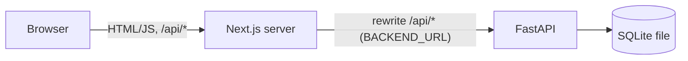
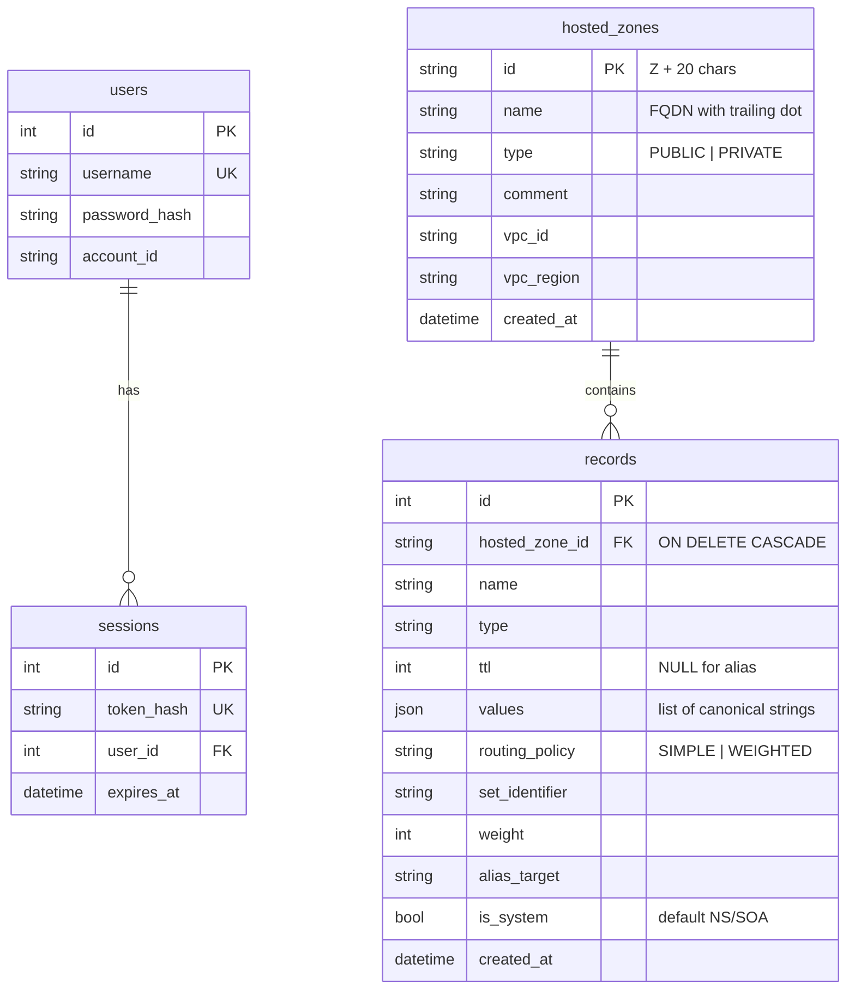

# Route 53 Console Clone

A functional clone of the AWS Route 53 console: manage **hosted zones** and **DNS records** through a
console-style UI backed by a real REST API and a real SQLite database. It doesn't resolve DNS; the goal is the
console experience (navigation, tables, forms, modals, validation, search, pagination) with data that persists.

> **Live demo:** <https://aws-route53-clone-pi-smoky.vercel.app>
>
> **API docs:** <https://route53-clone-api-vlgw.onrender.com/docs> (Render free plan: the first request after idle can take ~30–60 s, and the demo data resets whenever the service restarts).
>
> **Demo login:** username `admin` · password `Samarth1312`

## Contents

1. [Features](#features) · 2. [Tech stack](#tech-stack) · 3. [Architecture](#architecture) · 4. [Project structure](#project-structure) ·
5. [Database schema](#database-schema) · 6. [API overview](#api-overview) · 7. [Authentication](#authentication) ·
8. [Local setup](#local-setup) · 9. [Environment variables](#environment-variables) · 10. [Tests](#running-the-tests) ·
11. [Deployment](#deployment) · 12. [Design decisions](#design-decisions) · 13. [Known limitations](#known-limitations) · 14. [Bonus features](#bonus-features)

## Features

- **Mocked authentication**: sign in, sign out, session survives a refresh, protected routes redirect to `/login?next=…`.
- **Hosted zones**: list, search (name, description, ID), filter by type, paginate, create (public or private with VPC),
  view, edit the description, delete (type-to-confirm, with a warning when the zone still holds records).
  Creating a zone adds the default apex `NS` and `SOA` records, like Route 53.
- **DNS records** for `A`, `AAAA`, `CNAME`, `TXT`, `MX`, `NS`, `PTR`, `SRV` and `CAA`: list, search by name or value,
  filter by type, paginate, create, edit, delete one or many. The create/edit form changes with the record type
  (a textarea for IPs, priority + server rows for MX, four fields for SRV, flags/tag/value for CAA).
  Alias records (A/AAAA/CNAME) and weighted routing are supported.
- **Validation on both sides**: inline errors in the form for quick feedback; the API re-validates everything and
  its field errors are shown next to the right field.
- **Console details**: sidebar with selected state, breadcrumbs, dismissible notifications, skeleton loading rows,
  empty / no-match / error states with Retry, copy buttons, truncated long values, responsive layout with a nav drawer on phones.
- **Placeholder pages** (Dashboard counters are real; the rest are "Coming soon"): Traffic policies, Health checks, Resolver, Profiles.
- Bonus: see [Bonus features](#bonus-features).

## Tech stack

| Layer | Choice |
|---|---|
| Frontend | Next.js 16 (App Router), React 19, TypeScript (strict), CSS Modules, TanStack Query |
| Backend | FastAPI, Pydantic v2, SQLAlchemy 2, bcrypt |
| Database | SQLite |
| Tests | pytest + FastAPI TestClient; Vitest + Testing Library |

No UI kit or CSS framework: the AWS-console look comes from a small set of design tokens
(`frontend/src/app/tokens.css`) and hand-written components.

## Architecture



- The browser only talks to the Next.js origin. Next.js **rewrites `/api/*` to FastAPI**, so the session cookie is
  first-party, there's no CORS in production, and the backend URL never reaches the client.
- FastAPI is layered: `api/routes` (HTTP only) → `services` (business rules and validation) → `models` (SQLAlchemy).
  `schemas` are the Pydantic request/response contracts. Routes never touch the ORM directly.
- The frontend keeps **server state in TanStack Query** (one hook per resource) and **list state in the URL**
  (`?q=mail&type=MX&page=2`), so a filtered view survives refresh and can be shared. There is no global store.
- Every page handles four explicit states: loading (skeleton), error (message + Retry), empty, and data.

## Project structure

```
route53-clone/
├── render.yaml                  Render blueprint (backend + persistent disk)
├── backend/
│   ├── app/
│   │   ├── main.py              app factory, CORS, error handlers, startup (create tables, seed)
│   │   ├── api/                 deps.py (current user from cookie) · routes/{auth,hosted_zones,records}.py
│   │   ├── core/                config.py (env settings) · security.py (bcrypt, token hashing) · errors.py (error envelope)
│   │   ├── db/                  session.py (engine, FK pragma) · seed.py
│   │   ├── models/              user, session, hosted_zone, record
│   │   ├── schemas/             Pydantic request/response models
│   │   └── services/            auth, hosted_zone, record, dns_validation, zone_file (BIND/JSON)
│   └── tests/                   91 tests
└── frontend/
    ├── next.config.ts           /api/* → FastAPI rewrite
    ├── src/proxy.ts             redirects to /login when there's no session cookie
    └── src/
        ├── app/                 routes: /login, (console)/{dashboard,hosted-zones/**,traffic-policies,…}
        ├── components/          ui/ (generic) · layout/ · hosted-zones/ · records/
        ├── hooks/               useZones, useRecords, useAuth, useListParams
        ├── lib/                 api-client, validation, record-types (per-type fields + wire format), types
        └── __tests__/           72 tests
```

Routes: `/login` · `/dashboard` · `/hosted-zones` · `/hosted-zones/new` · `/hosted-zones/[zoneId]` ·
`/hosted-zones/[zoneId]/edit` · `/hosted-zones/[zoneId]/records/new` · `/hosted-zones/[zoneId]/records/[recordId]/edit` ·
`/traffic-policies` · `/health-checks` · `/resolver` · `/profiles`.

## Database schema



- **One record row = one Route 53 record set** (name + type, optionally + set identifier) holding a *list* of values,
  e.g. one `A` record with three IPs, or one `MX` record with several mail servers. Values are stored in canonical text
  (`10 mail.example.com.`, `0 issue "letsencrypt.org"`).
- Relational integrity: `records.hosted_zone_id` is a foreign key with `ON DELETE CASCADE`, and the engine enables
  `PRAGMA foreign_keys=ON` on every connection (SQLite ignores foreign keys otherwise). No orphan records are possible.
- Uniqueness: `(hosted_zone_id, name, type, set_identifier)` for records; `(name, type, vpc_id)` for zones (so the
  same name can exist as a public and a private zone, as in Route 53).
- Indexes: `records(hosted_zone_id)`, `records(hosted_zone_id, name)`, `records(hosted_zone_id, type)`, `hosted_zones(name)`, `sessions(token_hash)`.
- A zone's **record count is computed** with a correlated subquery rather than stored, so it cannot drift.
- Every zone gets a default apex `NS` and `SOA` record (`is_system = true`). They can't be deleted; only their TTL
  (and the `NS` values) can be edited.

## API overview

All endpoints are under `/api`. Interactive docs: `http://localhost:8000/docs`.

| Method | Path | Notes |
|---|---|---|
| POST | `/auth/login` | sets the `r53_session` cookie; `401 INVALID_CREDENTIALS` |
| POST | `/auth/logout` | deletes the session server-side → `204` |
| GET | `/auth/session` | current user, or `401` |
| GET | `/hosted-zones` | `page`, `page_size`, `search`, `type`, `sort`, `order` |
| POST | `/hosted-zones` | `201`; `409 HOSTED_ZONE_ALREADY_EXISTS`; `422` invalid domain / missing VPC |
| GET · PATCH · DELETE | `/hosted-zones/{id}` | PATCH edits the description only; DELETE needs `?force=true` if the zone has records, else `409 HOSTED_ZONE_NOT_EMPTY` |
| GET | `/hosted-zones/{id}/export` | `?format=json\|bind`, as a download |
| GET | `/hosted-zones/{id}/records` | `page`, `page_size`, `search` (name or value), `type`, `routing_policy`, `alias` |
| POST | `/hosted-zones/{id}/records` | `201`; `409` duplicate / CNAME conflict / routing-policy conflict; `422` invalid value |
| POST | `/hosted-zones/{id}/records/batch-delete` | `{ "ids": [...] }`, all-or-nothing |
| POST | `/hosted-zones/{id}/records/import` | `{ "content": "<BIND text>" }` → `{ created, skipped: [{line, reason}] }` |
| GET · PATCH · DELETE | `/records/{id}` | `400 SYSTEM_RECORD_PROTECTED` for the default NS/SOA |
| GET | `/health` | liveness probe |

Conventions: list endpoints return `{ items, total, page, page_size }` (`page ≥ 1`, `1 ≤ page_size ≤ 100`; invalid values are `422`).
Every error has one shape and never includes a stack trace:

```json
{ "error": { "code": "VALIDATION_ERROR", "message": "One or more values are invalid.",
             "details": [ { "field": "values.1", "message": "'999.1.1.1' is not a valid IPv4 address." } ] } }
```

**Validation** (`backend/app/services/dns_validation.py`): A → IPv4, AAAA → IPv6, CNAME/PTR → one hostname (CNAME not at the
apex and not alongside other types), NS → hostnames, MX → `priority host`, SRV → `priority weight port target`,
CAA → `flags tag "value"` with tag `issue|issuewild|iodef`, TXT → text (split into 255-byte chunks), TTL 0–2147483647,
weighted records need a record ID and weight 0–255, aliases take no values and no TTL. Record names must be inside the zone.
The frontend mirrors these rules in `src/lib/validation.ts` for instant feedback, but the backend never relies on it.

## Authentication

The brief allows mocking IAM, so this is kept simple: one seeded user (`DEMO_USERNAME` / `DEMO_PASSWORD`).

1. `POST /auth/login` checks the bcrypt hash (the same message for an unknown user and a wrong password), creates a random
   token, stores only its **SHA-256 hash** in the `sessions` table, and sets it in an **httpOnly, SameSite=Lax** cookie
   (`Secure` when `COOKIE_SECURE=true`). JavaScript can't read it.
2. Every other endpoint depends on `get_current_user`, which looks the token up and checks expiry (default 12 h).
3. **Logout** deletes the row, so a copied cookie stops working immediately. Refreshing the page re-checks the session, so it persists.
4. In the browser, `src/proxy.ts` cheaply redirects cookie-less visits to `/login`; `<AuthGate>` does the real check against the API, and any
   `401` from a later request sends the user back to `/login?next=…`. `next` only accepts same-site paths.

## Local setup

Requirements: **Python 3.11+**, **Node 20.19+** (22 recommended) and npm. Run the two servers in separate terminals.

**Backend** (`http://localhost:8000`)

```bash
cd backend
python -m venv .venv
source .venv/bin/activate          # Windows PowerShell: .venv\Scripts\Activate.ps1   (Git Bash: source .venv/Scripts/activate)
pip install -r requirements-dev.txt
cp .env.example .env               # optional: the defaults work as-is
uvicorn app.main:app --reload
```

**Frontend** (`http://localhost:3000`)

```bash
cd frontend
npm install
cp .env.example .env.local         # optional: BACKEND_URL defaults to http://localhost:8000
npm run dev
```

Open <http://localhost:3000> and sign in with **`admin` / `Route53Demo!`** (the defaults from `backend/.env.example`).

**Database.** There is nothing to initialize: on startup the backend creates the tables (`Base.metadata.create_all`) and, if the
database has no users, **seeds it**. The SQLite file is `backend/route53.db` (git-ignored) and persists across refreshes and restarts.
To start over: stop the server, delete `route53.db`, and start again, or run `python -m app.db.seed --reset`.

**Seed data.** 12 zones (10 public, including the reverse-lookup zone `10.in-addr.arpa`, and 2 private) with about 100 records using every supported type.
`example.com` has 29 records (multi-value `A`, `MX`, `TXT` SPF/DMARC, `CAA`, `SRV`, an alias, a weighted pair, a wildcard), so search,
the type filter and pagination can be tried straight away. Seed data is created through the same service layer as API writes, so it obeys the same validation.

## Environment variables

**Backend** (`backend/.env`, see `.env.example`)

| Variable | Default | Purpose |
|---|---|---|
| `DATABASE_URL` | `sqlite:///./route53.db` | SQLite location (use an absolute path on a persistent disk when deploying) |
| `CORS_ORIGINS` | `http://localhost:3000` | comma-separated allowed origins (only needed for direct cross-origin calls) |
| `SESSION_TTL_HOURS` | `12` | session lifetime |
| `COOKIE_SECURE` | `false` | set `true` behind HTTPS |
| `DEMO_USERNAME` / `DEMO_PASSWORD` | `admin` / `Route53Demo!` | the seeded user; **change the password in any deployment** (a warning is logged if you don't) |
| `SEED_ON_STARTUP` | `true` | seed an empty database on startup |

**Frontend** (`frontend/.env.local`, see `.env.example`)

| Variable | Default | Purpose |
|---|---|---|
| `BACKEND_URL` | `http://localhost:8000` | where Next.js proxies `/api/*` (server-side only) |
| `NEXT_PUBLIC_DEMO_HINT` | generic text | optional line under the sign-in form, e.g. to publish the demo credentials on a hosted demo |

Nothing secret is committed: `.env*` is git-ignored except the `.env.example` files.

## Running the tests

```bash
cd backend  && pytest                                     # 91 tests; ruff check . for lint
cd frontend && npm test && npm run lint && npm run typecheck && npm run build
```

- **Backend** (isolated in-memory SQLite per test): authentication incl. server-side logout; hosted-zone create / get / update / delete / list
  (search, filter, pagination, validation, duplicates, 404s, cascade with no orphans); records of **every type** (valid and invalid values), name resolution,
  TTL, CNAME rules, weighted routing, aliases, system-record protection, batch delete, query-parameter validation; BIND import/export and a round trip.
- **Frontend**: the validation rules, the per-type value serialization (including mapping server errors back to rows), `Pagination`, `ConfirmDialog`
  (type-to-confirm, Esc, focus trap, focus restore), and `RecordForm` (fields change by type, inline errors, API payload shape, edit mode).

## Deployment

Backend on Render, frontend on Vercel (the live URLs are at the top of this README).

**1. Backend on Render**: connect the repo and use the blueprint in `render.yaml` (Python service rooted at `backend/`, health check `/api/health`,
free plan). Set `DEMO_PASSWORD` and `CORS_ORIGINS` (your Vercel URL) in the dashboard.

> The blueprint uses Render's **free plan**, which has no persistent disk: the SQLite database is wiped and re-seeded whenever the service restarts or spins down,
> and free instances take ~30–60 s to wake up. For durable data, use a paid plan, add a `disk:` block mounted at `/var/data`, and set `DATABASE_URL=sqlite:////var/data/route53.db`.

**2. Frontend on Vercel**: import the repo, set the **Root Directory to `frontend`**, and add the environment variable
`BACKEND_URL=https://<your-render-service>.onrender.com` (and optionally `NEXT_PUBLIC_DEMO_HINT`). Deploy.

Next.js reads `BACKEND_URL` when it builds, so redeploy the frontend after changing it. Because Next.js proxies `/api`, no further cookie or CORS configuration is needed. Verify the build locally first:

```bash
cd frontend && npm run build && npm start        # with the backend running
```

SQLite is single-writer, so the backend should run as **one instance and one worker**; scaling out would mean moving to PostgreSQL (see limitations).

## Design decisions

| Decision | Why | Trade-off |
|---|---|---|
| Next.js **rewrites `/api/*`** to FastAPI | One origin for the browser: first-party cookie, no CORS or `SameSite=None` in production | An extra hop; the frontend needs `BACKEND_URL` |
| **Opaque session token** in an httpOnly cookie + `sessions` table | Real server-side logout, JS can't read it, trivial to explain | A DB lookup per request (negligible here); not stateless like JWT |
| A record = **record set with a list of values** | Matches Route 53 (one `A` with several IPs, multi-value `MX`/`TXT`) | Values are strings in canonical form, parsed per type |
| API takes **canonical text values**; the form parses/serializes structured fields | One simple wire format; the backend stays the authority | The frontend must mirror the formats (covered by tests) |
| **SQLAlchemy + `create_all`**, no Alembic | Keeps setup to one command for a small schema | No migration history (see limitations) |
| **Server-side** search / filter / pagination with state in the URL | Real API design; shareable, refresh-safe views | A request per change, softened with `keepPreviousData` |
| **TanStack Query**, no global store | Loading/error states and cache invalidation without hand-rolled fetch code | One extra dependency |
| **CSS Modules + design tokens**, no UI kit | Original work, no generic template look, easy to explain and to theme (dark mode is just a token swap) | More CSS written by hand |
| Backend validation is authoritative; frontend mirrors it | "Never trust the client" while keeping inline feedback | Rules live in two places (tests keep them aligned) |
| Zone delete is `409` unless `?force=true` | Mirrors Route 53 and prevents accidents via the API | The UI sends `force` only after the user typed the confirmation and saw the record count |

## Known limitations

- **Mocked** AWS: no IAM, accounts or billing; a single seeded user. No login rate limiting or account lockout.
- No real DNS: nothing is resolved or served; name servers are generated from the zone ID. No DNSSEC, tags, health checks, traffic policies, resolver or profiles (placeholders).
- Routing policies are limited to simple and weighted; there's no latency/geolocation/failover. `SOA` is read-only; records are `A`…`CAA` only.
- A zone's name and type can't be changed after creation (as in Route 53); in the UI a record's name and type are locked when editing (the API would allow changing them).
- **SQLite**: one writer, so one backend instance; the schema is created with `create_all`, so schema changes need a manual migration (Alembic would be the next step).
- CSRF protection relies on `SameSite=Lax` cookies and JSON request bodies rather than tokens.
- Visuals follow the Route 53 console's layout and spacing but use their own icons and no AWS fonts or logo.

## Bonus features

- **BIND import**: "Import zone file" on a zone's Records tab; paste or choose a file. Supports `$ORIGIN`, `$TTL`, comments, multi-line `( … )` records, relative / absolute names,
  repeated-name continuation lines and quoted `TXT` strings. Each record set goes through the normal validation; bad lines are skipped and reported with line numbers, and existing records are never overwritten.
- **Export** a zone as **JSON** or **BIND** from the zone page (aliases appear as comments in BIND since it has no alias type).
- **Bulk delete**: select several records and delete them in one request.
- **Dark mode**: account menu → *Dark mode* (remembered, applied before first paint so it doesn't flash).
- **Keyboard shortcuts**: `/` focuses the filter box, `c` starts creating a zone or record, `?` lists them (disabled while typing in a field).
